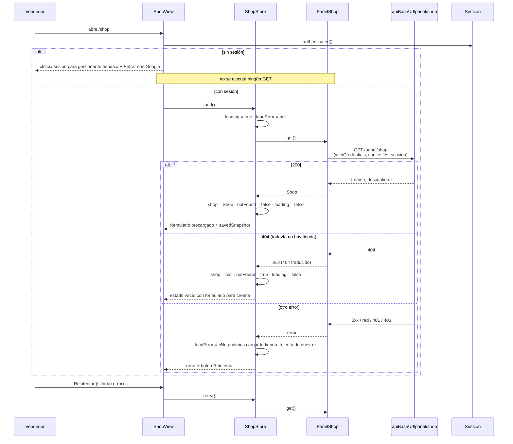
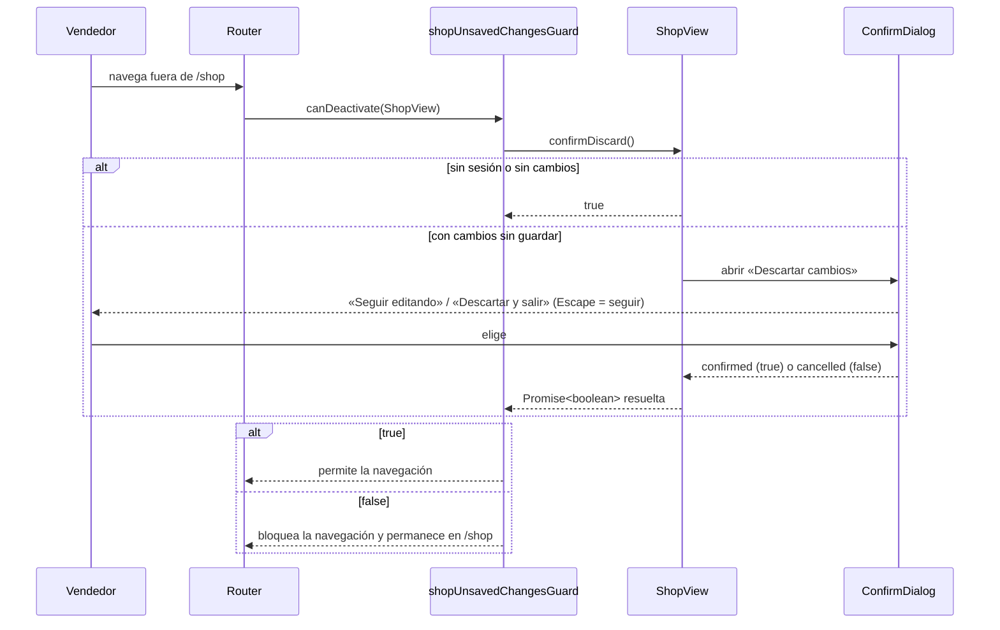
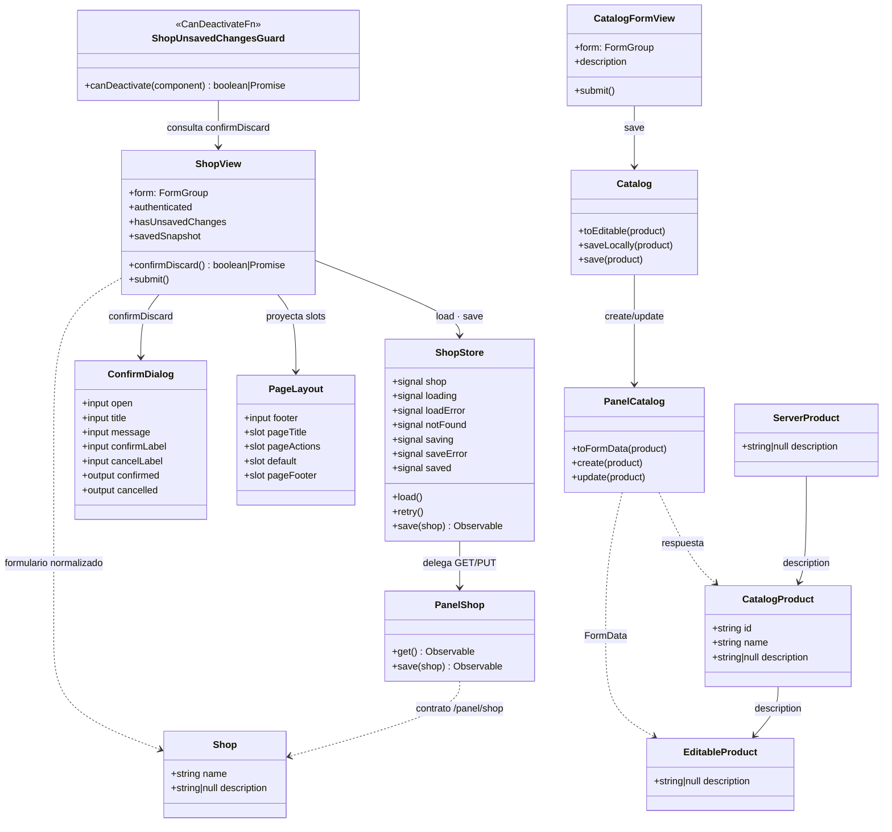
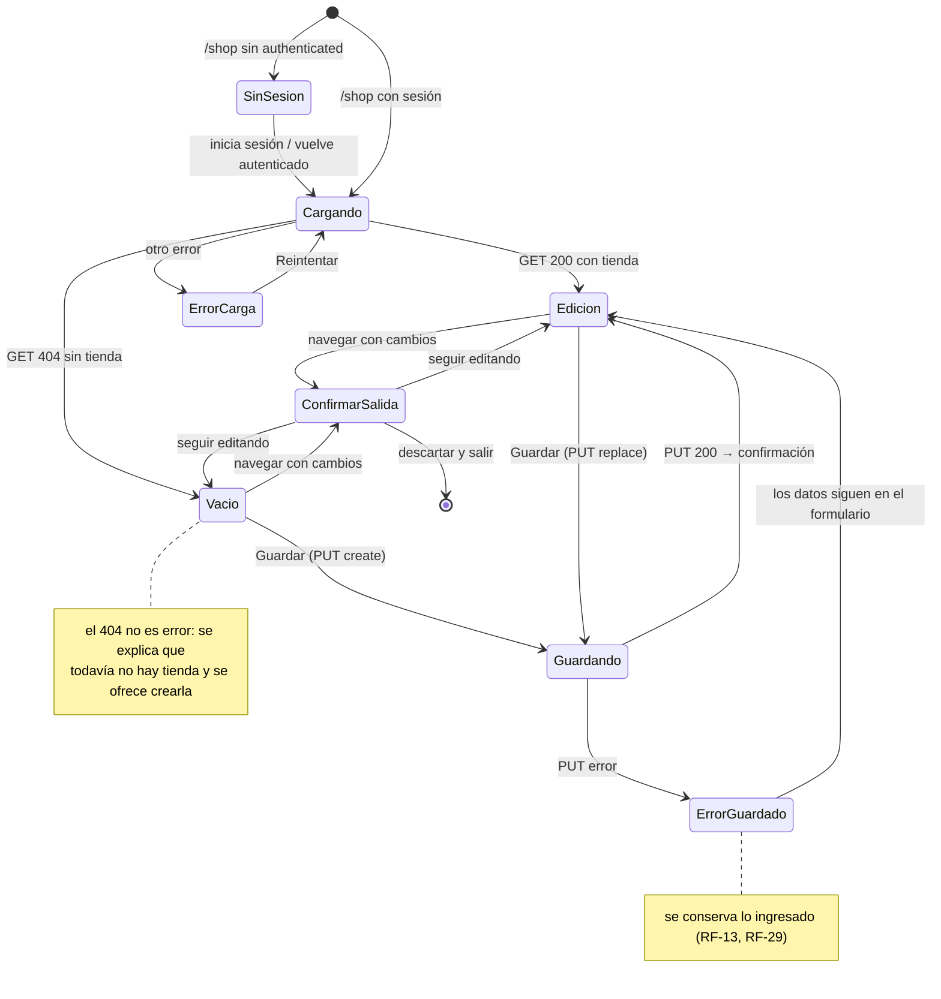

# UML 003 — Mi tienda y descripción de producto

Diagramas alineados con el plan y las tareas de esta spec para `panel-web` (Angular 21, SPA standalone). La prosa y los nombres visibles están en español; los identificadores de código conservan los nombres reales previstos (`Shop`, `PanelShop`, `ShopStore`, `ShopView`, `shopUnsavedChangesGuard`, rutas y variables de entorno).

Los diagramas priorizan relaciones arquitectónicas y de flujo; no reproducen cada import ni cada variable local. La frontera HTTP es la misma para todo el panel: `{environment.apiBaseUrl}` sin barra final, con `withCredentials: true` y cookie de sesión `fes_session` gestionada por `panel-api`.

## Contrato de tienda consumido

- `GET {apiBaseUrl}/panel/shop` → `200` con `{ name: string, description: string | null }`; `404` significa «todavía no hay tienda» y se traduce a `null` en `PanelShop`.
- `PUT {apiBaseUrl}/panel/shop` con cuerpo JSON `{ name, description }` → `200` con la tienda resultante. Es **create-or-replace**: crea si no existe y reemplaza nombre y descripción si ya existe.
- No se usan operaciones separadas de alta y edición, no hay persistencia de tienda en `panel-web` y no se llama a `account-api` desde el navegador.

## Estructura de componentes, servicios, modelos y rutas

```mermaid
flowchart TB
  subgraph bootstrap["Bootstrap y rutas"]
    main["main.ts<br/>bootstrapApplication(App, appConfig)"]
    config["app.config.ts<br/>provideRouter · provideHttpClient<br/>provideAppInitializer → Session.whenHydrated"]
    routes["app.routes.ts<br/>shop (lazy) · title «Mi tienda | Friendly E-Shop»<br/>canDeactivate: shopUnsavedChangesGuard"]
    env["environments/*<br/>apiBaseUrl"]
  end

  subgraph shell["Shell Admin UI"]
    app["App<br/>app.ts / app.html<br/>nav móvil + aside · «Mi tienda» solo con sesión"]
    session["Session<br/>authenticated · enterWithGoogle() · logout()"]
    layout["PageLayout · app-page-layout<br/>pageTitle · pageActions · default · pageFooter"]
  end

  subgraph view["Vista routeada"]
    shopView["ShopView<br/>views/shop/shop.ts · shop.html<br/>form reactivo · estados · confirmDiscard()"]
    guard["shopUnsavedChangesGuard<br/>views/shop/shop-unsaved-changes.guard.ts<br/>CanDeactivateFn‹ShopView›"]
    dialog["ConfirmDialog<br/>core/components/confirm-dialog/<br/>role=dialog · Escape · foco atrapado"]
  end

  subgraph state["Estado"]
    store["ShopStore<br/>core/services/shop/shop-store.ts<br/>signals: shop · loading · loadError · notFound<br/>saving · saveError · saved<br/>load() · retry() · save()"]
  end

  subgraph http["Frontera HTTP"]
    panelShop["PanelShop<br/>core/services/shop/panel-shop.ts<br/>GET/PUT {apiBaseUrl}/panel/shop<br/>withCredentials · 404→null"]
  end

  subgraph models["Modelos y límites"]
    shopModel["Shop<br/>core/models/shop.ts<br/>name · description: string | null"]
    limits["core/constants/shop-limits.ts<br/>SHOP_NAME_MIN/MAX · SHOP_DESCRIPTION_MAX"]
    productModel["CatalogProduct · EditableProduct · ServerProduct<br/>+ description: string | null"]
    productLimits["core/constants/product-limits.ts<br/>MAX_DESCRIPTION_LENGTH = 1000"]
  end

  subgraph product["Producto (spec 002 extendida)"]
    form["CatalogFormView<br/>views/catalog-form/<br/>+ control description"]
    catalog["Catalog<br/>core/services/catalog/catalog.ts"]
    panelCatalog["PanelCatalog<br/>core/services/catalog/panel-catalog.ts<br/>FormData con description"]
    list["CatalogListView<br/>views/catalog-list/<br/>aviso «Producto guardado.»"]
  end

  main --> config
  config --> app
  config --> routes
  app --> session
  routes --> shopView
  routes --> guard
  guard --> shopView
  shopView --> layout
  shopView --> dialog
  shopView --> store
  shopView --> session
  shopView ..> shopModel
  store --> panelShop
  panelShop --> env
  panelShop ..> shopModel
  shopModel --> limits
  form --> catalog
  form --> productLimits
  form ..> productModel
  catalog --> panelCatalog
  panelCatalog ..> productModel
  form --> list
```

## Secuencia: cargar la tienda



## Secuencia: guardar la tienda (crear o reemplazar)

```mermaid
sequenceDiagram
  participant User as Vendedor
  participant View as ShopView
  participant Store as ShopStore
  participant Panel as PanelShop
  participant API as apiBaseUrl/panel/shop

  User->>View: «Guardar» (header en sm+ / footer en móvil)
  View->>View: validar nombre 1–80 recortado y descripción ≤ 1000
  alt formulario inválido
    View-->>User: mensajes en español junto al campo
    Note over View,API: no se envía la petición
  else válido
    View->>View: normalizar name.trim() y description.trim() || null
    View->>Store: save(shop)
    Store->>Store: saving = true · saveError = null · saved = false
    Store->>Panel: save(shop)
    Panel->>API: PUT /panel/shop<br/>JSON { name, description }<br/>(withCredentials)
    alt 200
      API-->>Panel: Shop guardada
      Panel-->>Store: Shop
      Store->>Store: shop = Shop · saved = true · saving = false
      Store-->>View: éxito
      View->>View: savedSnapshot = Shop · hasUnsavedChanges = false
      View-->>User: «Guardaste los datos de tu tienda.» (role=status)
    else error
      API-->>Panel: 5xx / red / 401 / 403
      Panel-->>Store: error
      Store->>Store: saveError = «No pudimos guardar tu tienda. Intentá de nuevo.»
      Store-->>View: error
      View-->>User: mensaje de error; nombre y descripción siguen en el formulario
    end
  end
```

## Secuencia: salir con cambios sin guardar



## Secuencia: descripción de producto

```mermaid
sequenceDiagram
  participant User as Vendedor
  participant Form as CatalogFormView
  participant Catalog as Catalog
  participant Panel as PanelCatalog
  participant API as apiBaseUrl/panel/catalog
  participant List as CatalogListView

  alt editar producto existente
    Catalog-->>Form: CatalogProduct con description
    Form->>Form: patch description ?? ''
  end
  User->>Form: escribe descripción (≤ 1000) y guarda
  Form->>Form: Validators.maxLength(1000) · textarea maxlength=1000
  alt supera 1000
    Form-->>User: «La descripción no puede superar los 1000 caracteres.»
    Note over Form,API: no se envía la petición
  else válido
    Form->>Catalog: save(EditableProduct con description recortada o null)
    Catalog->>Panel: create()/update()
    Panel->>API: POST/PUT /panel/catalog/products<br/>multipart/form-data con description
    alt 2xx
      API-->>Panel: producto con description
      Panel-->>Catalog: CatalogProduct(description)
      Catalog-->>Form: éxito
      Form->>List: navigate('/catalog', { guardado: 'producto' })
      List-->>User: «Producto guardado.» (role=status)
    else error
      API-->>Panel: error
      Panel-->>Catalog: error
      Catalog-->>Form: saveError
      Form-->>User: error; la descripción ingresada se conserva
    end
  end
```

## Diagrama de clases



## Estados de la pantalla Mi tienda


